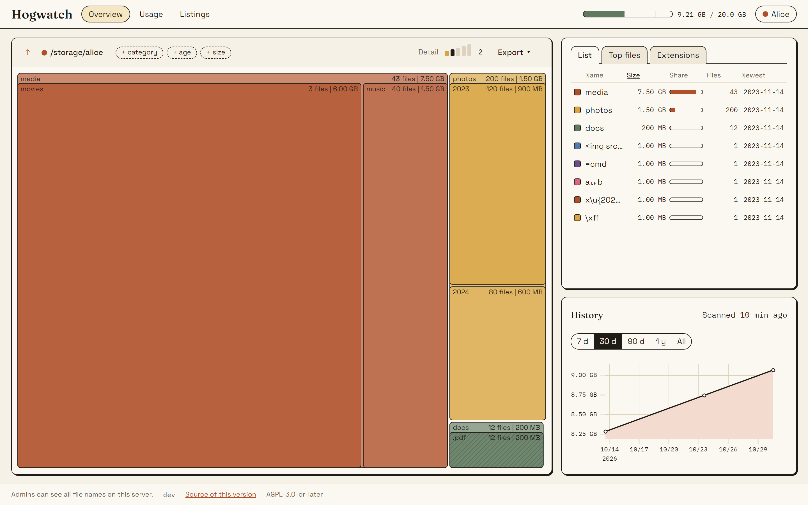

<p align="center"></p>

# Hogwatch

A self-hosted disk usage analyzer in the spirit of TreeSize and WinDirStat, delivered as a web app and deployed with Docker Compose.



- Treemap, list, top files and extensions, with filters for category, age and size
- Every scan is kept, so you see what grew
- Per-user folders and quotas, local accounts and optional OIDC sign-in
- Safe by design: the web part never touches your files; a read-only, minimal-privilege scanner does
- Optional ZFS quota and snapshot numbers

**Documentation:** https://vinrosso.github.io/hogwatch/

## Install

Needs Docker 25+ with Compose and a Linux kernel 5.12+ (amd64 or arm64).

```bash
mkdir hogwatch && cd hogwatch
curl -fsSLO https://github.com/vinRosso/hogwatch/releases/latest/download/compose.yaml
curl -fsSL  https://github.com/vinRosso/hogwatch/releases/latest/download/env.example -o .env
# edit .env and set SCAN_PATH to the folder you want to analyze
docker compose up -d
docker compose logs hogwatch-web   # prints the setup address
```

## Status

Pre-release. The first release, v0.1.0, is being prepared.

## License

Copyright (C) the Hogwatch contributors.

This program is free software: you can redistribute it and/or modify it under the terms of the GNU Affero General Public License as published by the Free Software Foundation, either version 3 of the License, or (at your option) any later version. It is distributed WITHOUT ANY WARRANTY; see the [LICENSE](LICENSE) file for details. SPDX: `AGPL-3.0-or-later`.

## Contributing

See [CONTRIBUTING.md](CONTRIBUTING.md).

### Generated code

`make gen` regenerates the sqlc and OpenAPI Go code; `cd web && npm run gen:api` regenerates `web/src/lib/api/schema.d.ts` from `api/openapi.yaml`. CI fails when either is stale. `make docs` builds the documentation site and `make docs-shots` retakes its screenshots.
